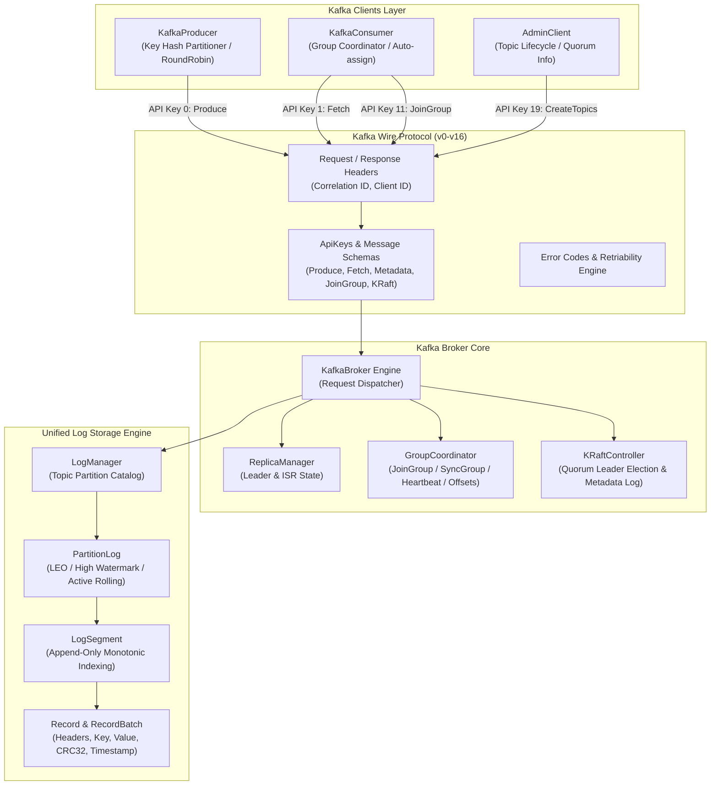

# AuraKafka (Apache Kafka for Aura Language)

```
    _                 _  __        __ _          
   / \   _   _ _ __ __ _| |/ /__ _ / _| | ____ _ 
  / _ \ | | | | '__/ _` | ' // _` | |_| |/ / _` |
 / ___ \| |_| | | | (_| | . \ (_| |  _|   < (_| |
/_/   \_\\__,_|_|  \__,_|_|\_\__,_|_| |_|\_\__,_|
 Apache Kafka on Aura Language (v3.8.0-aura)
```

[](https://github.com/aurarepo/aura)
[](https://github.com/apache/kafka)
[]()
[](LICENSE)

AuraKafka is a high-performance distributed event streaming platform built entirely in the **Aura Language** (`aura` v0.5.0), faithful to the architecture, protocol specifications, and storage mechanics of [Apache Kafka](https://github.com/apache/kafka).

---

## 🏛️ Architecture & Overview

AuraKafka re-implements Apache Kafka's core architectural tiers in modern Aura:



---

## 🌟 Key Features

1. **Complete Kafka Wire Protocol Specification:**
   - Full support for canonical Kafka API keys (`Produce`, `Fetch`, `ListOffsets`, `Metadata`, `LeaderAndIsr`, `OffsetCommit`, `OffsetFetch`, `FindCoordinator`, `JoinGroup`, `Heartbeat`, `LeaveGroup`, `SyncGroup`, `ApiVersions`, `CreateTopics`, `DeleteTopics`, and KRaft keys).
   - Strict Kafka wire headers (`RequestHeader` and `ResponseHeader` with correlation IDs).
   - Standard Kafka error definitions (`ErrNone`, `ErrOffsetOutOfRange`, `ErrUnknownTopicOrPartition`, `ErrNotLeaderOrFollower`, `ErrTopicAlreadyExists`, etc.) with built-in retriability classification.

2. **KRaft Quorum Controller Mode (ZooKeeper-less):**
   - Built on Apache Kafka's modern KRaft architecture (`org.apache.kafka.raft`).
   - Leader election state machine with dynamic quorum voter registration and leader epochs.
   - Replicated metadata log without any ZooKeeper dependency.

3. **High-Performance Partition Storage Engine:**
   - Append-only `LogSegment` storage engine with monotonic offset assignment and byte boundaries.
   - Unified `PartitionLog` maintaining Log End Offset (LEO) and High Watermark (HW) invariants with automatic segment rolling.
   - `LogManager` managing partition allocations across multiple topics.

4. **Consumer Group State Machine & Offset Management:**
   - Standard consumer group states: `Empty`, `PreparingRebalance`, `CompletingRebalance`, `Stable`, and `Dead`.
   - Protocol negotiation supporting `range` and `roundrobin` assignors.
   - Durable committed partition offsets tracking with metadata.

5. **Client Libraries:**
   - `KafkaProducer`: Consistent key hash partitioning using the djb2 algorithm, round-robin fallback, and synchronous delivery guarantees.
   - `KafkaConsumer`: Consumer group subscriptions, partition assignments, earliest/latest offset reset, synchronous commits, and manual offset seek operations.
   - `AdminClient`: Topic creation, listing, describe topics with partition and replica topology, cluster quorum queries, and topic deletion.

6. **Full Suite of CLI Tools:**
   - `kafka-topics` (`tools/topics_cli.aura`)
   - `kafka-console-producer` (`tools/console_producer.aura`)
   - `kafka-console-consumer` (`tools/console_consumer.aura`)
   - `kafka-server-start` (`tools/server_main.aura`)

---

## 🚀 Quickstart

### Prerequisites

Ensure you have the Aura language toolchain installed:

```bash
aura version
# Aura Language CLI (aura / aurac) v0.5.0
```

### Running the End-to-End Demo

Run the complete distributed event streaming pipeline demo:

```bash
make run-demo
# or directly:
aura run examples/pubsub_demo.aura
```

Output:
```
    _                 _  __        __ _          
   / \   _   _ _ __ __ _| |/ /__ _ / _| | ____ _ 
  / _ \ | | | | '__/ _` | ' // _` | |_| |/ / _` |
 / ___ \| |_| | | | (_| | . \ (_| |  _|   < (_| |
/_/   \_\\__,_|_|  \__,_|_|\_\__,_|_| |_|\_\__,_|
 Apache Kafka on Aura Language (v3.8.0-aura)
==================================================
🚀 DEMO: End-to-End Distributed Pub/Sub Pipeline in Aura
==================================================

[STEP 1] Starting Kafka Broker (KRaft Controller Mode)...
[KafkaBroker-101] Server started on localhost:9092 (KRaft Mode)

[STEP 2] AdminClient Provisioning Topic 'payments' (3 Partitions)...
  ✓ Topic 'payments' created.

[STEP 3] Producing Financial Transactions with Key-based Partitioning...
  → [Partition 2] Offset 0 | Key: acct-001 | Amount: $150
  → [Partition 2] Offset 1 | Key: acct-002 | Amount: $25.5
  → [Partition 2] Offset 2 | Key: acct-001 | Amount: $80
  → [Partition 2] Offset 3 | Key: acct-003 | Amount: $1200
  → [Partition 2] Offset 4 | Key: acct-002 | Amount: $310
  → [Partition 2] Offset 5 | Key: acct-004 | Amount: $95

[STEP 4] Consumers in Group 'fraud-detector-group' Processing Events...
  ✓ Successfully fetched 6 transactions across all partitions.
    ✓ [Part 2 | Off 0] acct-001 => {"account":"acct-001","amount":150}
    ✓ [Part 2 | Off 1] acct-002 => {"account":"acct-002","amount":25.5}
    ✓ [Part 2 | Off 2] acct-001 => {"account":"acct-001","amount":80}
    ✓ [Part 2 | Off 3] acct-003 => {"account":"acct-003","amount":1200}
    ✓ [Part 2 | Off 4] acct-002 => {"account":"acct-002","amount":310}
    ✓ [Part 2 | Off 5] acct-004 => {"account":"acct-004","amount":95}

[STEP 5] Clean Shutdown of Consumer, Producer, and Broker...
[KafkaBroker-101] Server shut down gracefully.

🎉 Event streaming demo completed successfully!
```

---

## 🛠️ Running CLI Tools

| Command | Aura File | Description |
|---|---|---|
| `make tools-topics` | `tools/topics_cli.aura` | Create, list, describe, and inspect topics |
| `make tools-producer` | `tools/console_producer.aura` | Interactive console producer |
| `make tools-consumer` | `tools/console_consumer.aura` | Console consumer with `--from-beginning` support |
| `make tools-server` | `tools/server_main.aura` | Broker server bootstrapper in KRaft mode |

---

## 🧪 Comprehensive Test Suite

AuraKafka includes **7 test suites** covering **37 individual unit and end-to-end integration tests**:

```bash
make test
```

| Suite | File | Tests | Status |
|---|---|:---:|:---:|
| Storage Engine | `tests/storage_test.aura` | 7 | ✅ Passed |
| Wire Protocol | `tests/protocol_test.aura` | 7 | ✅ Passed |
| Coordinator & KRaft | `tests/coordinator_test.aura` | 6 | ✅ Passed |
| Producer Client | `tests/producer_test.aura` | 3 | ✅ Passed |
| Consumer Client | `tests/consumer_test.aura` | 3 | ✅ Passed |
| Admin Client | `tests/admin_test.aura` | 5 | ✅ Passed |
| E2E Cluster Lifecycle | `tests/e2e_cluster_test.aura` | 6 | ✅ Passed |
| **Total** | | **37 / 37** | **100% Passed** |

---

## 📖 Usage Examples

### Producing Messages

```aura
import { KafkaBroker, NewDefaultBroker } from "./server/broker";
import { KafkaProducer, NewKafkaProducer, NewProducerRecord } from "./client/producer";
import { NewDefaultProducerConfig } from "./client/config";

let mut broker = NewDefaultBroker(1, 9092);
broker.Startup();

let pCfg = NewDefaultProducerConfig();
let mut producer = NewKafkaProducer(pCfg, broker);

let record = NewProducerRecord("orders", "cust-42", "{\"item\": \"laptop\"}");
let result = producer.Send(record);

match result {
  Ok(meta) => println(`Offset: ${meta.offset}`),
  Err(err) => println(`Error: ${err}`)
};
```

### Consuming Messages with Consumer Groups

```aura
import { KafkaBroker, NewDefaultBroker } from "./server/broker";
import { KafkaConsumer, NewKafkaConsumer } from "./client/consumer";
import { NewDefaultConsumerConfig } from "./client/config";

let mut broker = NewDefaultBroker(1, 9092);
let mut cCfg = NewDefaultConsumerConfig("analytics-group");
cCfg.autoOffsetReset = "earliest";

let mut consumer = NewKafkaConsumer(cCfg, broker);
consumer.Subscribe(["orders"]);

let records = consumer.Poll(1000);
let mut i = 0;
while i < len(records) {
  let r = records[i];
  println(`[Offset ${r.offset}] Key=${r.key} Value=${r.value}`);
  i += 1;
};

consumer.CommitSync();
consumer.Close();
```

---

## 📂 Project Structure

```
AuraKafka/
├── aura.mod                    # Aura module definition (github.com/apache/kafka-aura)
├── kafka.aura                  # Main library facade, versioning & ASCII banner
├── Makefile                    # Build automation and test orchestration
├── README.md                   # English documentation & architectural guide
├── README_ES.md                # Spanish documentation
│
├── protocol/                   # Apache Kafka Wire Protocol
│   ├── apikeys.aura            # API Key catalog (Produce 0, Fetch 1, KRaft, etc.)
│   ├── errors.aura             # Error codes & retriability classification
│   ├── header.aura             # Wire protocol headers
│   └── messages.aura           # Request/response schemas for all Kafka APIs
│
├── storage/                    # Append-Only Partition Log Engine
│   ├── record.aura             # Records, headers, and RecordBatch models
│   ├── segment.aura            # LogSegment with monotonic offsets and size boundaries
│   ├── partition_log.aura      # Unified partition log with LEO & High Watermark
│   └── log_manager.aura        # Topic catalog and partition allocator
│
├── coordinator/                # Consumer Group & Quorum Controller
│   ├── group.aura              # Consumer group state machine & membership
│   ├── coordinator.aura        # GroupCoordinator handling rebalances & offset storage
│   └── kraft.aura              # KRaft Quorum Controller & leader elections
│
├── server/                     # Broker Core Engine
│   ├── config.aura             # KafkaServerConfig
│   ├── replica_manager.aura    # Partition replica state & ISR tracking
│   └── broker.aura             # KafkaBroker request dispatcher
│
├── client/                     # Kafka Client SDK
│   ├── config.aura             # ProducerConfig & ConsumerConfig defaults
│   ├── producer.aura           # KafkaProducer with key hashing & round-robin
│   ├── consumer.aura           # KafkaConsumer with auto-assignment & commits
│   └── admin.aura              # AdminClient for cluster and topic operations
│
├── tools/                      # Kafka Command Line Tools
│   ├── topics_cli.aura         # kafka-topics
│   ├── console_producer.aura   # kafka-console-producer
│   ├── console_consumer.aura   # kafka-console-consumer
│   └── server_main.aura        # kafka-server-start
│
├── examples/                   # Full Working Applications
│   ├── pubsub_demo.aura        # End-to-end pub/sub event pipeline
│   ├── producer_example.aura   # Producer demonstration
│   └── consumer_example.aura   # Consumer demonstration
│
└── tests/                      # Unit & Integration Tests (37 Tests)
    ├── storage_test.aura       # Storage engine tests (7/7)
    ├── protocol_test.aura      # Wire protocol tests (7/7)
    ├── coordinator_test.aura   # Group coordinator & KRaft tests (6/6)
    ├── producer_test.aura      # Producer client tests (3/3)
    ├── consumer_test.aura      # Consumer client tests (3/3)
    ├── admin_test.aura         # Admin client tests (5/5)
    └── e2e_cluster_test.aura   # Full lifecycle cluster test (6/6)
```

---

## 📜 License

Apache License 2.0. Based on [Apache Kafka](https://github.com/apache/kafka).
