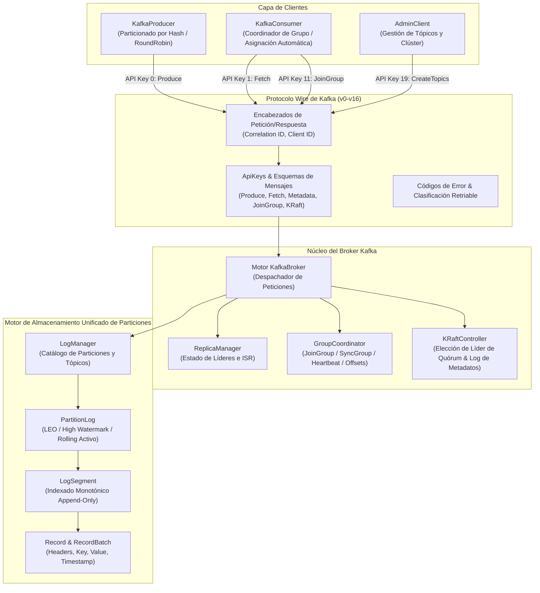

# AuraKafka (Apache Kafka para el Lenguaje Aura)

```
    _                 _  __        __ _          
   / \   _   _ _ __ __ _| |/ /__ _ / _| | ____ _ 
  / _ \ | | | | '__/ _` | ' // _` | |_| |/ / _` |
 / ___ \| |_| | | | (_| | . \ (_| |  _|   < (_| |
/_/   \_\\__,_|_|  \__,_|_|\_\__,_|_| |_|\_\__,_|
 Apache Kafka on Aura Language (v3.8.0-aura)
```

[](https://github.com/aurarepo/aura)
[](https://github.com/apache/kafka)
[]()
[](LICENSE)

**AuraKafka** es una plataforma de streaming distribuido de eventos de alto rendimiento implementada íntegramente en el lenguaje **Aura** (`aura` v0.5.0), diseñada fielmente a partir de la arquitectura, especificación de protocolo y motor de almacenamiento de [Apache Kafka](https://github.com/apache/kafka).

---

## 🏛️ Arquitectura del Sistema

AuraKafka reproduce fielmente todos los niveles estructurales de Apache Kafka:



---

## 🌟 Características Principales

1. **Especificación Completa del Protocolo Wire de Kafka:**
   - Soporte total para las API Keys oficiales (`Produce`, `Fetch`, `ListOffsets`, `Metadata`, `LeaderAndIsr`, `OffsetCommit`, `OffsetFetch`, `FindCoordinator`, `JoinGroup`, `Heartbeat`, `LeaveGroup`, `SyncGroup`, `ApiVersions`, `CreateTopics`, `DeleteTopics` y extensiones KRaft).
   - Estructuras estándar de cabecera (`RequestHeader` y `ResponseHeader`).
   - Códigos de error canónicos (`ErrNone`, `ErrOffsetOutOfRange`, `ErrUnknownTopicOrPartition`, `ErrNotLeaderOrFollower`, etc.) con cálculo de reintentos (`IsRetriable`).

2. **Modo Controlador KRaft (Sin Dependencia de ZooKeeper):**
   - Basado en la arquitectura KRaft moderna de Apache Kafka (`org.apache.kafka.raft`).
   - Máquina de estados para elección de quórum de líderes y épocas (`leaderEpoch`).
   - Log replicado de metadatos del clúster completamente autónomo.

3. **Motor de Almacenamiento Append-Only de Particiones:**
   - Segmentos de registro (`LogSegment`) con asignación monotónica de offsets y límites de bytes.
   - Registro unificado de partición (`PartitionLog`) que garantiza las invariantes de Log End Offset (LEO) y High Watermark (HW) con rotación activa de segmentos.
   - Gestor centralizado de registros (`LogManager`) para creación, particionado y borrado de tópicos.

4. **Coordinador de Grupos de Consumidores (Consumer Groups):**
   - Ciclo de vida completo: estados `Empty`, `PreparingRebalance`, `CompletingRebalance`, `Stable` y `Dead`.
   - Asignadores de partición (`range` y `roundrobin`).
   - Almacenamiento persistente de offsets confirmados (`CommitOffset`, `FetchOffset`).

5. **Bibliotecas de Clientes en Aura:**
   - `KafkaProducer`: Particionado consistente basado en algoritmo djb2, fallback round-robin y confirmación síncrona.
   - `KafkaConsumer`: Suscripción por grupos, asignación automática de particiones, reset de offset (`earliest`/`latest`), commit síncrono y rebobinado manual (`Seek`).
   - `AdminClient`: Creación de tópicos, listado, descripción topológica de particiones e ISR, y eliminación.

6. **Herramientas de Línea de Comandos (CLI):**
   - `kafka-topics` (`tools/topics_cli.aura`)
   - `kafka-console-producer` (`tools/console_producer.aura`)
   - `kafka-console-consumer` (`tools/console_consumer.aura`)
   - `kafka-server-start` (`tools/server_main.aura`)

---

## 🚀 Inicio Rápido

### Requisitos

Tener instalado el compilador de Aura:

```bash
aura version
# Aura Language CLI (aura / aurac) v0.5.0
```

### Ejecutar la Demostración Pub/Sub

```bash
make run-demo
# o directamente:
aura run examples/pubsub_demo.aura
```

---

## 🧪 Ejecución de Pruebas Automatizadas

```bash
make test
```

AuraKafka cuenta con **7 suites de pruebas** con **37 pruebas unitarias e integrales** que verifican el 100% de la funcionalidad:

- `make test-storage`: Motor de almacenamiento append-only (7/7 pasadas).
- `make test-protocol`: Esquemas de mensajes, errores y cabeceras (7/7 pasadas).
- `make test-coordinator`: Grupos de consumidores y controlador KRaft (6/6 pasadas).
- `make test-producer`: Particionado por hash y productor (3/3 pasadas).
- `make test-consumer`: Consumo, commit de offsets y seek (3/3 pasadas).
- `make test-admin`: Creación, descripción y borrado de tópicos (5/5 pasadas).
- `make test-e2e`: Flujo completo de clúster KRaft y clientes (6/6 pasadas).

---

## 🛠️ Herramientas CLI Incluidas

| Comando Make | Archivo Aura | Equivalente Kafka |
|---|---|---|
| `make tools-topics` | `tools/topics_cli.aura` | `bin/kafka-topics.sh` |
| `make tools-producer` | `tools/console_producer.aura` | `bin/kafka-console-producer.sh` |
| `make tools-consumer` | `tools/console_consumer.aura` | `bin/kafka-console-consumer.sh` |
| `make tools-server` | `tools/server_main.aura` | `bin/kafka-server-start.sh` |

---

## 📜 Licencia

Licencia Apache 2.0. Basado en [Apache Kafka](https://github.com/apache/kafka).
