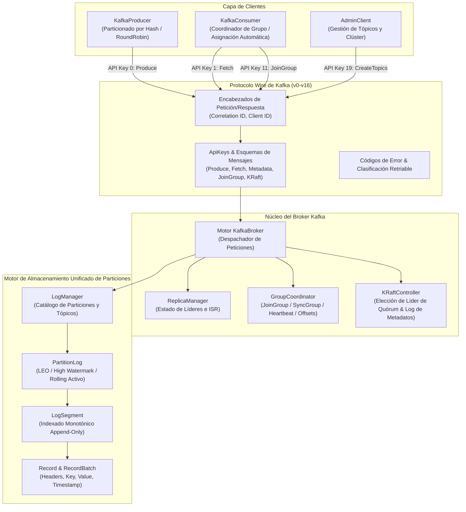

# AuraKafka (Apache Kafka para el Lenguaje Aura)

```
    _                 _  __        __ _          
   / \   _   _ _ __ __ _| |/ /__ _ / _| | ____ _ 
  / _ \ | | | | '__/ _` | ' // _` | |_| |/ / _` |
 / ___ \| |_| | | | (_| | . \ (_| |  _|   < (_| |
/_/   \_\\__,_|_|  \__,_|_|\_\__,_|_| |_|\_\__,_|
 Apache Kafka on Aura Language (v3.8.0-aura)
```

[](https://github.com/aurarepo/aura)
[](https://github.com/apache/kafka)
[]()
[](LICENSE)

**AuraKafka** es una plataforma de streaming distribuido de eventos de alto rendimiento implementada íntegramente en el lenguaje **Aura** (`aura` v0.5.0), diseñada fielmente a partir de la arquitectura, especificación de protocolo y motor de almacenamiento de [Apache Kafka](https://github.com/apache/kafka).

---

## 📑 Tabla de Contenidos

- [🏛️ Arquitectura del Sistema](#️-arquitectura-del-sistema)
- [🌟 Características Principales](#-características-principales)
- [🚀 Inicio Rápido](#-inicio-rápido)
- [⚡ Flujo de Ejecución en Ambiente Local](#-flujo-de-ejecución-en-ambiente-local)
  - [Pasos Manuales del Flujo](#pasos-manuales-del-flujo)
  - [Automatización con el Script start-local.sh](#automatización-con-el-script-start-localsh)
  - [Tabla de Opciones de start-local.sh](#tabla-de-opciones-de-start-localsh)
- [🐳 Despliegue con Docker Compose (Ambiente Local)](#-despliegue-con-docker-compose-ambiente-local)
- [🔨 Compilación de Binarios Nativos Standalone](#-compilación-de-binarios-nativos-standalone)
  - [🌟 Binario Único Unificado (bin/aurakafka) - Recomendado](#-binario-único-unificado-binaurakafka---recomendado)
  - [Requisitos Previos y Directorio de Salida](#requisitos-previos-y-directorio-de-salida)
  - [Comandos de Creación de Build](#comandos-de-creación-de-build)
  - [Banderas de Optimización](#banderas-de-optimización)
  - [Diferencia entre aura build y aura run](#diferencia-entre-aura-build-y-aura-run)
- [🧪 Ejecución de Pruebas Automatizadas](#-ejecución-de-pruebas-automatizadas)
- [🛠️ Herramientas CLI Incluidas](#️-herramientas-cli-incluidas)
- [🌐 Portal Web Embebido & Dashboard de Observabilidad](#-portal-web-embebido--dashboard-de-observabilidad)
- [📂 Estructura del Proyecto](#-estructura-del-proyecto)
- [📜 Licencia](#-licencia)

---

## 🏛️ Arquitectura del Sistema

AuraKafka reproduce fielmente todos los niveles estructurales de Apache Kafka:



---

## 🌟 Características Principales

1. **Especificación Completa del Protocolo Wire de Kafka:**
   - Soporte total para las API Keys oficiales (`Produce`, `Fetch`, `ListOffsets`, `Metadata`, `LeaderAndIsr`, `OffsetCommit`, `OffsetFetch`, `FindCoordinator`, `JoinGroup`, `Heartbeat`, `LeaveGroup`, `SyncGroup`, `ApiVersions`, `CreateTopics`, `DeleteTopics` y extensiones KRaft).
   - Estructuras estándar de cabecera (`RequestHeader` y `ResponseHeader`).
   - Códigos de error canónicos (`ErrNone`, `ErrOffsetOutOfRange`, `ErrUnknownTopicOrPartition`, `ErrNotLeaderOrFollower`, etc.) con cálculo de reintentos (`IsRetriable`).

2. **Modo Controlador KRaft (Sin Dependencia de ZooKeeper):**
   - Basado en la arquitectura KRaft moderna de Apache Kafka (`org.apache.kafka.raft`).
   - Máquina de estados para elección de quórum de líderes y épocas (`leaderEpoch`).
   - Log replicado de metadatos del clúster completamente autónomo.

3. **Motor de Almacenamiento Append-Only de Particiones:**
   - Segmentos de registro (`LogSegment`) con asignación monotónica de offsets y límites de bytes.
   - Registro unificado de partición (`PartitionLog`) que garantiza las invariantes de Log End Offset (LEO) y High Watermark (HW) con rotación activa de segmentos.
   - Gestor centralizado de registros (`LogManager`) para creación, particionado y borrado de tópicos.

4. **Coordinador de Grupos de Consumidores (Consumer Groups):**
   - Ciclo de vida completo: estados `Empty`, `PreparingRebalance`, `CompletingRebalance`, `Stable` y `Dead`.
   - Asignadores de partición (`range` y `roundrobin`).
   - Almacenamiento persistente de offsets confirmados (`CommitOffset`, `FetchOffset`).

5. **Bibliotecas de Clientes en Aura:**
   - `KafkaProducer`: Particionado consistente basado en algoritmo djb2, fallback round-robin y confirmación síncrona.
   - `KafkaConsumer`: Suscripción por grupos, asignación automática de particiones, reset de offset (`earliest`/`latest`), commit síncrono y rebobinado manual (`Seek`).
   - `AdminClient`: Creación de tópicos, listado, descripción topológica de particiones e ISR, y eliminación.

6. **Herramientas de Línea de Comandos (CLI):**
   - `kafka-topics` (`tools/topics_cli.aura`)
   - `kafka-console-producer` (`tools/console_producer.aura`)
   - `kafka-console-consumer` (`tools/console_consumer.aura`)
   - `kafka-server-start` (`tools/server_main.aura`)

---

## 🚀 Inicio Rápido

### Requisitos

Tener instalado el compilador de Aura:

```bash
aura version
# Aura Language CLI (aura / aurac) v0.5.0
```

### Ejecutar la Demostración Pub/Sub

```bash
make run-demo
# o directamente:
aura run examples/pubsub_demo.aura
```

---

## ⚡ Flujo de Ejecución en Ambiente Local

Para levantar y probar los servicios de AuraKafka en tu entorno local, el proyecto cuenta con un flujo completo de 4 etapas que comprende desde el arranque del Broker KRaft hasta la producción y consumo de registros en tópicos particionados.

### Pasos Manuales del Flujo

Si deseas ejecutar cada componente de manera independiente paso a paso:

```bash
# 1. Verificar la sintaxis y tipos de todos los módulos
make check

# 2. Iniciar el Broker Server en modo KRaft (Daemon)
aura run tools/server_main.aura

# 3. Aprovisionar y describir tópicos (kafka-topics)
aura run tools/topics_cli.aura

# 4. Producir eventos de prueba (kafka-console-producer)
aura run tools/console_producer.aura

# 5. Consumir eventos con un grupo de consumidores (kafka-console-consumer)
aura run tools/console_consumer.aura

# 6. Ejecutar el pipeline distribuido completo End-to-End
aura run examples/pubsub_demo.aura
```

---

### Automatización con el Script `start-local.sh`

Para simplificar el proceso y evitar ejecutar múltiples comandos por separado, se incluye el script automatizado [`start-local.sh`](file:///Users/rojasmauricio/Projects/AuraProjects/aura-kafka/start-local.sh) en la raíz del repositorio.

#### Dar permisos de ejecución:
```bash
chmod +x start-local.sh
```

#### Ejecutar el flujo completo de inicialización:
```bash
./start-local.sh
```

Este comando ejecuta de forma secuencial:
1. Verificación del compilador `aura` en el sistema.
2. Inicialización de los directorios locales de trabajo (`bin/`, `data/`).
3. Arranque del **Broker Server** (verificación de salud del clúster KRaft).
4. Creación de los tópicos `orders-stream` y `user-events` con particiones e ISR.
5. Publicación de eventos en tiempo real con particionado consistente por llave (djb2).
6. Consumo y commit de offsets desde el inicio (`--from-beginning`) mediante Consumer Group.

---

### Tabla de Opciones de `start-local.sh`

El script permite interactuar modularmente con los distintos servicios mediante banderas:

| Comando | Acción Realizada | Archivo Asociado |
|---|---|---|
| `./start-local.sh` | Flujo integral completo de inicialización y prueba | Secuencia completa |
| `./start-local.sh --docker` | Levanta el stack local completo con Docker Compose | `docker-compose.yml` |
| `./start-local.sh --server` | Inicia el broker en modo KRaft y ejecuta healthcheck | `tools/server_main.aura` |
| `./start-local.sh --topics` | Crea, lista y describe tópicos y particiones | `tools/topics_cli.aura` |
| `./start-local.sh --producer` | Envía mensajes de prueba a un tópico particionado | `tools/console_producer.aura` |
| `./start-local.sh --consumer` | Consume mensajes desde el principio (`--from-beginning`) | `tools/console_consumer.aura` |
| `./start-local.sh --demo` | Ejecuta la demo pub/sub completa con métricas | `examples/pubsub_demo.aura` |
| `./start-local.sh --bench` | Ejecuta el micro-benchmark de throughput | `tests/benchmark.aura` |
| `./start-local.sh --check` | Valida todos los archivos fuente con el compilador | `kafka.aura` y submódulos |
| `./start-local.sh --test` | Ejecuta las 37 pruebas unitarias e integrales | `tests/*_test.aura` |
| `./start-local.sh --clean` | Limpia binarios generados y archivos temporales | `bin/`, `*.tmp.*` |
| `./start-local.sh --help` | Muestra la ayuda y lista de comandos | - |

---

## 🐳 Despliegue con Docker Compose (Ambiente Local)

AuraKafka incluye una especificación de orquestación [`docker-compose.yml`](file:///Users/mauriciorojas/Projects/AuraProjects/aura-kafka/docker-compose.yml) lista para producción y desarrollo local que levanta todos los componentes y servicios requeridos:

| Servicio | Contenedor | Puerto(s) | Descripción |
|---|---|---|---|
| **AuraKafka Web Portal** | `aurakafka-web` | `9095:9090` | Dashboard en tiempo real, KPIs, monitor de lag, topología interactiva y simulador |
| **Apache Kafka Broker** | `aurakafka-broker` | `9092:9092` | Broker KRaft oficial (v3.8.0) de alto rendimiento sin ZooKeeper |
| **Topic Initializer** | `aurakafka-init-topics` | Interno | Inicialización automática de tópicos (`orders-stream`, `user-events`, etc.) |
| **Provectus Kafka UI** | `aurakafka-ui` | `8080:8080` | Interfaz gráfica web para exploración de clúster, tópicos, mensajes y consumidores |
| **Schema Registry** | `aurakafka-schema-registry` | `8081:8081` | Registro de esquemas Confluent para formatos Avro/JSON/Protobuf |
| **Aura CLI & Tools** | `aurakafka-cli` | - | Entorno contenedorizado con el compilador Aura (perfil `--profile tools`) |

### Comandos de Gestión:

```bash
# Iniciar todos los servicios en segundo plano:
docker compose up -d
# o mediante el script automatizado:
./start-local.sh --docker
# o usando Make:
make docker-up

# Ver el estado y salud de los contenedores:
docker compose ps
# o: make docker-ps

# Inspeccionar logs en tiempo real:
docker compose logs -f
# o: make docker-logs

# Detener todos los servicios:
docker compose down
# o: make docker-down
```

### URLs de Acceso Local:
- **AuraKafka Observability Portal & KPIs:** `http://localhost:9095`
- **Provectus Kafka UI:** `http://localhost:8080`
- **Confluent Schema Registry:** `http://localhost:8081`
- **Kafka Broker (Bootstrap Server):** `localhost:9092`

---

## 🔨 Compilación de Binarios Nativos Standalone

AuraKafka puede ser compilado a binarios ejecutables nativos independientes (Mach-O en macOS, ELF en Linux) mediante el comando `aura build` del compilador de Aura. Estos ejecutables son autocontenidos y no requieren dependencias externas ni entornos de ejecución adicionales.

### Requisitos Previos y Directorio de Salida

Antes de compilar, asegúrate de crear el directorio de destino para los binarios (por ejemplo, `bin/`):

```bash
mkdir -p bin
```

### 🌟 Binario Único Unificado (`bin/aurakafka`) - Recomendado

AuraKafka incluye un punto de entrada centralizado [`cli.aura`](file:///Users/rojasmauricio/Projects/AuraProjects/aura-kafka/cli.aura) que permite empaquetar y ejecutar **todos los componentes del proyecto** (Broker, Topics, Producer, Consumer, Demo y Benchmark) mediante un único ejecutable standalone:

```bash
# Compilar el binario unificado:
make build
# o invocando directamente el compilador Aura:
aura build cli.aura -o bin/aurakafka --release
```

Una vez generado, puedes ejecutar cualquier servicio pasando el subcomando deseado:

```bash
./bin/aurakafka server     # Iniciar Broker Server en modo KRaft (Daemon)
./bin/aurakafka topics     # Aprovisionar, listar y describir tópicos
./bin/aurakafka producer   # Publicar eventos con particionado consistente
./bin/aurakafka consumer   # Consumir eventos con grupos de consumidores
./bin/aurakafka demo       # Pipeline distribuido completo Pub/Sub
./bin/aurakafka bench      # Micro-benchmark de throughput de mensajes
./bin/aurakafka help       # Ayuda y lista de subcomandos disponibles
```

> [!TIP]
> También puedes ejecutar el CLI unificado de inmediato en modo interactivo sin necesidad de compilarlo previamente:
> ```bash
> make cli
> # o directamente:
> aura run cli.aura help
> aura run cli.aura server
> aura run cli.aura demo
> ```

---

### Compilación de Componentes Individuales (Opcional)

#### 1. Servidor Broker Kafka (`bin/kafka-server`)
Compila el daemon del broker de Kafka con modo KRaft (`tools/server_main.aura`):
```bash
aura build tools/server_main.aura -o bin/kafka-server --release
```
Para ejecutar el broker nativo:
```bash
./bin/kafka-server
```

#### 2. Micro-Benchmark de Rendimiento (`bin/kafka-benchmark`)
Compila la suite de benchmark síncrono de alto rendimiento para el productor y consumidor (`tests/benchmark.aura`):
```bash
aura build tests/benchmark.aura -o bin/kafka-benchmark --release -O3
```
Para ejecutar el benchmark:
```bash
./bin/kafka-benchmark
```

#### 3. Herramientas CLI de Gestión y Streaming
Compila los ejecutables de administración y consola de Kafka:
```bash
# Herramienta de administración de tópicos (kafka-topics)
aura build tools/topics_cli.aura -o bin/kafka-topics --release

# Productor de consola interactivo (kafka-console-producer)
aura build tools/console_producer.aura -o bin/kafka-console-producer --release

# Consumidor de consola interactivo (kafka-console-consumer)
aura build tools/console_consumer.aura -o bin/kafka-console-consumer --release
```

#### 4. Demostración Pub/Sub Completa
Compila la demo de pipeline de eventos distribuido:
```bash
aura build examples/pubsub_demo.aura -o bin/kafka-pubsub-demo --release
./bin/kafka-pubsub-demo
```

### Banderas de Optimización

| Bandera | Descripción |
|---|---|
| `-o <ruta>` | Especifica la ruta y nombre del binario generado (ej. `-o bin/kafka-server`). |
| `--release` | Habilita optimizaciones de producción y eliminación de código muerto. |
| `-O3` | Nivel máximo de optimizaciones para throughput y velocidad de procesamiento. |
| `--target native` | Compila directamente para la arquitectura de la máquina anfitriona (Apple Silicon / x86_64). |

### Diferencia entre `aura build` y `aura run`

- **`aura build <archivo.aura> -o <binario>`**: Genera en disco un ejecutable binario nativo compilado en código máquina para distribución independiente y máximo rendimiento en producción.
- **`aura run <archivo.aura>`**: Modo interactivo para desarrollo, ejecución inmediata de pruebas unitarias (`make test`) y prototipado rápido sin generar binarios persistentes.

---

## 🧪 Ejecución de Pruebas Automatizadas

```bash
make test
```

AuraKafka cuenta con **7 suites de pruebas** con **37 pruebas unitarias e integrales** que verifican el 100% de la funcionalidad:

- `make test-storage`: Motor de almacenamiento append-only (7/7 pasadas).
- `make test-protocol`: Esquemas de mensajes, errores y cabeceras (7/7 pasadas).
- `make test-coordinator`: Grupos de consumidores y controlador KRaft (6/6 pasadas).
- `make test-producer`: Particionado por hash y productor (3/3 pasadas).
- `make test-consumer`: Consumo, commit de offsets y seek (3/3 pasadas).
- `make test-admin`: Creación, descripción y borrado de tópicos (5/5 pasadas).
- `make test-e2e`: Flujo completo de clúster KRaft y clientes (6/6 pasadas).

---

## 🛠️ Herramientas CLI Incluidas

| Comando Make | Archivo Aura | Equivalente Kafka |
|---|---|---|
| `make tools-topics` | `tools/topics_cli.aura` | `bin/kafka-topics.sh` |
| `make tools-producer` | `tools/console_producer.aura` | `bin/kafka-console-producer.sh` |
| `make tools-consumer` | `tools/console_consumer.aura` | `bin/kafka-console-consumer.sh` |
| `make tools-server` | `tools/server_main.aura` | `bin/kafka-server-start.sh` |
| `make web` | `web/server.ts` | Portal Web & Dashboard de Observabilidad |

---

## 🌐 Portal Web Embebido & Dashboard de Observabilidad

AuraKafka incluye un **Portal Web de Control y Observabilidad** embebido de alto rendimiento, desarrollado con **React**, **TypeScript** y **Vite**, diseñado para interactuar con todas las funcionalidades del clúster, visualizar flujos de eventos y monitorizar la salud operativa en tiempo real.

### 🌟 Capacidades del Portal Web

1. **📊 Dashboard de Observabilidad & KPIs:**
   - **Throughput en Vivo:** Gráfico SVG en tiempo real (últimos 30 segundos) de tasa de ingestión (msgs/s) vs tasa de consumo procesado.
   - **Métricas Clave:** Total de mensajes producidos/consumidos, volumen en bytes, latencia promedio y distribución de particiones.
   - **Consumer Lag:** Monitor de desfasaje entre el Log End Offset (LEO) y el Committed Offset para cada grupo de consumidores.
   - **Salud del Clúster:** Estado de Quórum KRaft, líder activo, época y uso del motor de almacenamiento en disco.

2. **🌊 Visualizador de Flujo de Datos (Pipeline Topológico):**
   - Diagrama interactivo en 4 etapas: **Productores &rarr; Broker KRaft &rarr; Logs de Partición &rarr; Grupos de Consumidores**.
   - Animación de paquetes de eventos en tiempo real fluyendo entre los nodos del clúster.
   - Simulador de tráfico integrado (Play/Pausa, inyección de ráfagas) e inspector de nodos.

3. **🛠️ Administración de Tópicos & Particiones:**
   - Catálogo interactivo de tópicos, particiones, réplicas ISR y High Watermark.
   - Modal para creación de tópicos con política de limpieza (`delete`, `compact`) y retención.
   - Explorador de mensajes almacenados en los segmentos append-only.

4. **📤 Consola de Publicación (Producer Console):**
   - Envío de mensajes con particionado automático por hash de clave o asignación directa.
   - Plantillas predefinidas (Pedidos e-commerce, Pagos financieros, Telemetría IoT).
   - Generador de cabeceras Kafka personalizadas y visor de historial de publicaciones.

5. **📥 Consola de Consumo & Grupos (Consumer Console):**
   - Monitor de grupos de consumo (`Stable`, miembros, rebalances).
   - Lector de streams en vivo con polling y decodificación de payloads JSON.

6. **📜 Consola de Logs Operacionales:**
   - Transmisión en tiempo real vía WebSocket de eventos del broker, KRaft, storage y clientes.
   - Filtrado por nivel de severidad (`INFO`, `WARN`, `ERROR`, `DEBUG`) y subsistema.
   - Búsqueda instantánea, auto-scroll, copiado y descarga de logs en formato `.txt`.

### 🚀 Comandos de Ejecución del Portal Web

```bash
# Opción 1: Mediante Makefile (Compila y arranca el gateway en http://localhost:9090)
make web

# Opción 2: Mediante el script automatizado
./start-local.sh --web

# Opción 3: Modo Desarrollo con Hot Reload (Vite HMR en puerto 3000 con proxy a 9090)
make dev-web
```

---

## 📂 Estructura del Proyecto

```
AuraKafka/
├── aura.mod                    # Definición del módulo Aura (github.com/apache/kafka-aura)
├── kafka.aura                  # Fachada de la biblioteca, versionamiento y banner ASCII
├── Makefile                    # Automatización de tareas, pruebas y verificación
├── README.md                   # Documentación principal en inglés
├── README_ES.md                # Documentación en español
│
├── protocol/                   # Protocolo Wire de Apache Kafka
│   ├── apikeys.aura            # Catálogo de API Keys (Produce 0, Fetch 1, KRaft, etc.)
│   ├── errors.aura             # Códigos de error canónicos y clasificación retriable
│   ├── header.aura             # Encabezados de paquetes Request/Response
│   └── messages.aura           # Esquemas de mensajes para todas las APIs de Kafka
│
├── storage/                    # Motor de Almacenamiento Append-Only de Particiones
│   ├── record.aura             # Modelos de Record, cabeceras y RecordBatch
│   ├── segment.aura            # LogSegment con offsets monotónicos y límites de tamaño
│   ├── partition_log.aura      # Log de partición unificado con LEO y High Watermark
│   └── log_manager.aura        # Catálogo de tópicos y asignación de particiones
│
├── coordinator/                # Coordinador de Grupos y Controlador de Quórum
│   ├── group.aura              # Máquina de estados y membresía del grupo de consumidores
│   ├── coordinator.aura        # GroupCoordinator gestionando rebalances y almacenamiento de offsets
│   └── kraft.aura              # Controlador de Quórum KRaft y elecciones de líder
│
├── server/                     # Núcleo del Broker Kafka
│   ├── config.aura             # Configuración del servidor (KafkaServerConfig)
│   ├── replica_manager.aura    # Estado de réplicas de particiones y seguimiento de ISR
│   └── broker.aura             # KafkaBroker despachador de peticiones
│
├── client/                     # SDK de Clientes Kafka en Aura
│   ├── config.aura             # Valores por defecto de ProducerConfig y ConsumerConfig
│   ├── producer.aura           # KafkaProducer con particionado por hash y round-robin
│   ├── consumer.aura           # KafkaConsumer con asignación automática y commits
│   └── admin.aura              # AdminClient para operaciones de clúster y tópicos
│
├── tools/                      # Herramientas de Línea de Comandos (CLI)
│   ├── topics_cli.aura         # kafka-topics
│   ├── console_producer.aura   # kafka-console-producer
│   ├── console_consumer.aura   # kafka-console-consumer
│   └── server_main.aura        # kafka-server-start
│
├── examples/                   # Aplicaciones y Demostraciones
│   ├── pubsub_demo.aura        # Demostración del pipeline pub/sub distribuido
│   ├── producer_example.aura   # Demostración de uso del productor
│   └── consumer_example.aura   # Demostración de uso del consumidor
│
└── tests/                      # Suites de Pruebas Unitarias e Integración (37 Pruebas)
    ├── storage_test.aura       # Pruebas del motor de almacenamiento (7/7)
    ├── protocol_test.aura      # Pruebas del protocolo wire (7/7)
    ├── coordinator_test.aura   # Pruebas de coordinador y KRaft (6/6)
    ├── producer_test.aura      # Pruebas del cliente productor (3/3)
    ├── consumer_test.aura      # Pruebas del cliente consumidor (3/3)
    ├── admin_test.aura         # Pruebas del cliente administrativo (5/5)
    └── e2e_cluster_test.aura   # Pruebas integrales del ciclo de vida del clúster (6/6)
```

---

## 📜 Licencia

Licencia Apache 2.0. Basado en [Apache Kafka](https://github.com/apache/kafka).

